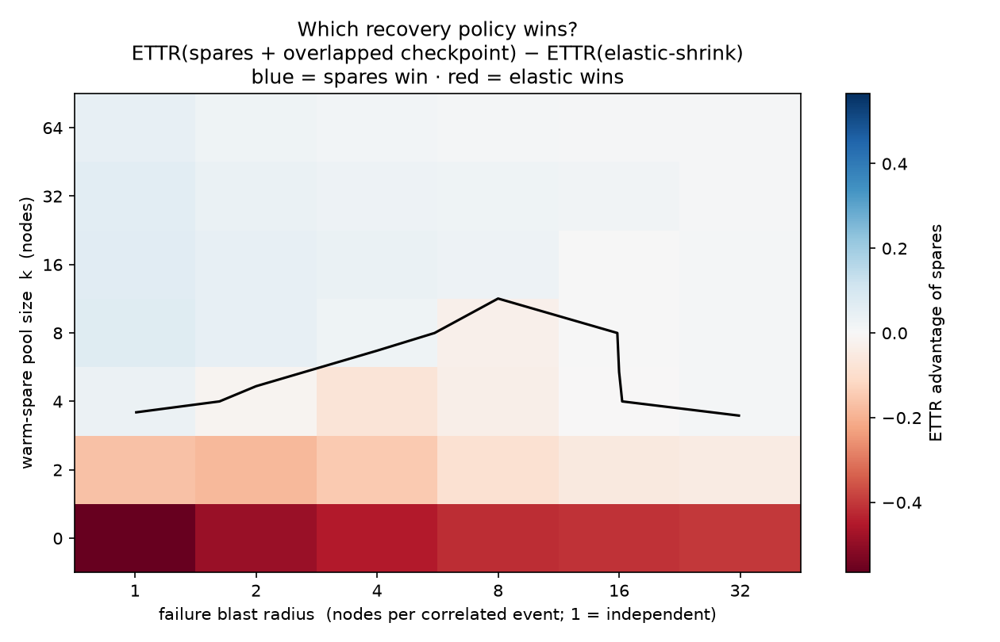
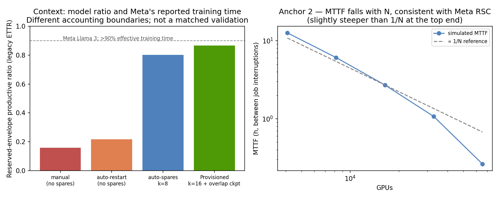

# Reliability Economics: which recovery policy wins in which failure regime

**At scale a GPU cluster faults every few hours, so you will spend on recovery — the question is on *what*.** Warm spares, elastic degradation, frequent checkpointing, faster repair: which one buys the most usable capacity per dollar is not fixed — it depends on your failure process. This repository maps it, with a reproducible simulator that reports the answer in a reserved-capacity productive ratio and recovery diagnostics and in dollars.

**TL;DR:** the headline is a **phase diagram**, not a number. On a 16,384-GPU training job, no-spares loses to elastic-shrink in the modeled sweep; **elastic-shrink is competitive across the modeled sweep (~0.80)** that beats a tiny spare pool even under independent failures; a **right-sized pool + overlapped checkpointing (k ≈ 8) is the best policy (~0.87), but only in a band and by a thin margin** — and *over-provisioning the pool is charged and hurts*. The gap between a naive and a well-provisioned recovery posture is **~\$21M/month on one cluster**. The modeled productive ratio is ~0.87 versus ~0.16–0.22 for naive recovery. Meta's reported training-time measures supply context, not an interchangeable denominator or a validation of these capacity valuations.

*Third quantitative pillar of the DIMAGGI series on turning GPU capital into usable compute, and the companion to the [Chaos Fidelity Standard](https://github.com/dimaggi-ai/ai-cluster-chaos-fidelity) — chaos certifies that a recovery behavior works; this prices what it is worth. Full analysis in [docs/study.md](docs/study.md) and the staged preprint [paper/paper.md](paper/paper.md); all claims trace to [REFERENCES.md](REFERENCES.md).*

---

## Why this exists (and why it was rebuilt)

An earlier model reported a single number — "two warm nodes is the biggest lever, 83%." Five independent expert reviews and a [prototype](prototype/) showed that was an artifact of a single-Poisson, policy-independent fault process. This is the rebuild. It fixes five things the critique demanded — shared latent events, correlated failures, a finite spare queue, checkpoint-as-a-policy with write cost, and a realistic elastic cost — and reports the phase map instead of the number. The [v0 baseline](v0-baseline/) is kept for reference and contrast.

## The finding



Blue = warm spares + overlapped checkpoint win; red = elastic-shrink wins. The winner is a *region* of `(failure blast radius × spare-pool size)`, not an ordering. A two-node pool — the thing the old model sold — sits on the losing side of the line for any real blast radius. Details, the crossover, the checkpoint optimum, and the dollar table are in [docs/study.md](docs/study.md).

## Economic claim and assumptions

<!-- economics-headline:start -->
**Committed independent-failure scenario:** 16,384 active GPUs, 30 days (720 hours), seeds 0–7, valued at an assumed $2.50/GPU-hour.

Mean modeled nonproductive-capacity value: manual/no spares **$24,816,774.875**; elastic/no spares **$5,907,455.875**; automated recovery with eight spare nodes and overlapped checkpointing **$3,862,799.875**.

Subtracting the committed `waste_dollars` values gives **$20,953,975.000** versus manual (about $21M), and **$2,044,656.000** versus elastic (**$2,044,656** rounded to whole dollars). These are modeled capacity valuations, not realized cash savings.
<!-- economics-headline:end -->

The pool is **eight additional nodes / 64 GPUs**, not eight GPUs removed from the 16,384-GPU job: `64 × 720 × $2.50 = $115,200` of reserved-capacity value is included. The model does not separately itemize electricity, facilities, storage/network charges, repair labor, software, capital financing or revenue. The hourly rate is a scenario valuation, not a current quote or total-cost-of-ownership estimate. [The study](docs/study.md#the-economics) gives the failure/recovery inputs, rounding order, and the prior published snapshot; [CSV](results/results.csv) and [generated table](results/summary.md) make the arithmetic inspectable without running code.

## Comparison with public anchors



A configuration with a right-sized pool, overlapped checkpointing and fast detection reaches a modeled productive ratio of ~0.87. Meta reports >90% effective training time [1], but this is contextual evidence with a different scope; MTTF falls with cluster size, consistent with Meta RSC's ∝ 1/N (slightly steeper at the top end) [2] — though rate ∝ N is an *input* of the fault generator, so this is a direction check, not a fitted validation. The model compares recovery policies; it does not reproduce Meta's production result or establish that hardware, workloads and accounting boundaries are identical.

These anchors are machine-checked by a six-point validation registry
([sim/validation.py](sim/validation.py)) run in CI, split into three
kinds by how much each is actually worth.

**Calibrated** points pin constants fitted to published figures so they
cannot drift silently: the single-node fault rate (1.58×10⁻⁴/node-h,
implied by 419 interruptions / 54 days / 2,048 nodes [1]) and the
latent-fault count it generates at the published exposure (413.5 vs
419, inside a band set at 1.2× the Poisson sd of a 419-count). Neither
is evidence — the rate was *derived from* 419, so these points cannot
disagree with their own reference by more than sampling noise, and the
registry says so.

**Emergent** behavior includes the swept checkpoint-interval optimum, which lands within 0.5% of Young's first-order √(2wM) [5], with a band derived from grid resolution rather than fitted.

**Internal regression band:** the local reserved-envelope productive ratio (legacy `ettr` field) is **0.865** at the 54-day reference exposure. The historical `0.85 ≤ ettr < 0.90` check is retained only to detect changes to this selected model configuration. Its upper limit is not a validation against Meta's >90% lower bound: the quantities have different accounting boundaries. Zero recovery latency scores 0.947 and doubled reload time falls below the band; both are negative controls against silent changes to the recovery assumptions.

**Sanity** points pin the model's own machinery and cite nothing.
An automation-class policy surfaces 91% of latent faults as separate
interruptions (vs a naive no-spare posture's 107, a 3.5× gap that *is*
policy-conditioned — the repo's core point). And MTTF degradation
steepens past linear across four doublings (2.07×, 2.25×, 2.53×,
4.07×): a ~2× ratio is *structural*, since rate ∝ N is an input of the
generator, so only the excess above 2× — the recovery layer saturating
at width — is a model result. Agreement with Meta's ∝1/N [2] and the
LANL study [10] is a direction check discussed in
[docs/study.md](docs/study.md), not evidence produced here.

The registry also prints the external outcomes it **declines** to reproduce: [1]'s >90% training-time figure as a matched metric, [2]'s absolute ~1.8 h MTTF projection, and [3]'s <1% checkpoint overhead. Synthetic data is the seeded
latent-event generator itself.

```
cd sim && python3 validation.py     # the registry, model vs public record
```

## Reproduce

```
pip install -r sim/requirements.txt
make test        # invariants, validation registry, result/prose consistency
make figures     # regenerate figures/results, then refresh marked economic prose
```

The consistency check regenerates all 22 CSV rows, the summary and 324 sensitivity scenarios (972 policy runs) in ignored temporary storage, then verifies three exact manifest values and the three marked economic claim blocks. `make figures` refreshes figures, tables and sensitivity together, then updates those blocks only after the numerical artifacts agree. It does not refresh provenance hashes; review the changed outputs before resealing `evidence.json`. Other prose is hand-maintained and must be reviewed when assumptions change.

Python 3.11+, `numpy`, `matplotlib`. Seeded and deterministic; checks run in [CI](.github/workflows/ci.yml).

## Honest scope

One gang **training** job (no inter-job scheduling — the [scheduling repo](https://github.com/dimaggi-ai/scheduler-vs-more-gpus); no inference — a different metric); deterministic blast radius and point recovery times; progress linear in usable width above the legal-shape floor. The contribution is the phase structure and the method, with calibrated inputs and internal checks; absolute cell values are site-specific. The full "what a skeptic should attack" list is in [docs/study.md](docs/study.md#what-a-skeptic-should-attack) — pre-empting the critique is the point.

## Series — turning GPU capital into usable compute

- **GPU Cluster Networking** ([network-vs-more-gpus](https://github.com/dimaggi-ai/network-vs-more-gpus))
- **GPU Cluster Scheduling** ([scheduler-vs-more-gpus](https://github.com/dimaggi-ai/scheduler-vs-more-gpus))
- **Chaos Fidelity Standard** ([ai-cluster-chaos-fidelity](https://github.com/dimaggi-ai/ai-cluster-chaos-fidelity)) — certifies the experiments
- **Reliability Economics** (this work) — prices which recovery policy wins where
- **Governed Autonomy for GPU Clusters and Networks** (next)

---

*Margaret (Maggie) Nanyonga — Founder & Principal Architect, [DIMAGGI AI](https://dimaggi.ai). Governed AI infrastructure: the control, reliability, and audit layer for autonomous systems operating production networks and compute.*
