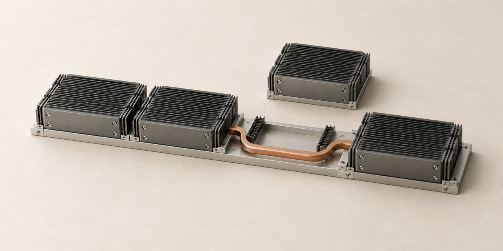

# Cover artwork — reliability-economics



Unbranded conceptual illustration for this project. These miniature physical models
communicate the subject; they are not engineering diagrams or photographs of deployed hardware.

| File | Use | Dimensions |
| --- | --- | --- |
| [social-preview-v1.jpg](social-preview-v1.jpg) | GitHub social preview | 1280 × 640 |
| [linkedin-v1.jpg](linkedin-v1.jpg) | Website sharing / LinkedIn artwork | 1200 × 627 |
| [cover-v1.png](cover-v1.png) | Full-resolution master | 1774 × 887 |

Both JPEG exports are below 1 MB. The LinkedIn export removes a small amount from
the sides to fit its recommended aspect ratio; the subject is preserved.

## Activate the repository preview

Committing these files does not configure GitHub's social preview.
Open [repository settings](https://github.com/dimaggi-ai/reliability-economics/settings),
find **Social preview → Edit → Upload an image**, and select `social-preview-v1.jpg`.
See [GitHub's instructions](https://docs.github.com/en/repositories/managing-your-repositorys-settings-and-features/customizing-your-repository/customizing-your-repositorys-social-media-preview).

For a website link, use `linkedin-v1.jpg` as the page's public `og:image`, with
its own title, description and canonical URL. See [LinkedIn's requirements](https://www.linkedin.com/help/linkedin/answer/a521928/making-your-website-shareable-on-linkedin).
Then check a fresh link in [LinkedIn Post Inspector](https://www.linkedin.com/post-inspector/)
and inspect the actual Featured card. Cached or existing cards may need to be re-added.

## Production notes

Created with Codex's built-in image generation tool. Final artwork was visually
reviewed. Exported with macOS `sips` for dimensions and JPEG compression.
No text, logo, author name, date, neon lighting or performance claims appear in the image.

Style reference: [Network cover](https://github.com/dimaggi-ai/network-vs-more-gpus/blob/main/assets/covers/cover-v1.png), used for materials, palette and lighting only.

Alt text: A displaced compute module and an alternate copper path around the gap in a cluster rail.

### Generation prompt

```text
Use case: stylized-concept. Make a NEW editorial cover illustration for GPU-cluster reliability and recovery research. Reference image 1 is only a palette/material/lighting reference, not an edit target. Use a genuinely different subject/composition.
Landscape exactly 2:1, preferably 1280 x 640. Absolutely no text.
Primary concept: preserving useful operation when a component fails. An understated physical engineering maquette: a short row of four small, finely finned matte-graphite compute modules on a slender pale-metal rail. The third module is lifted slightly out of its socket and rests nearby, leaving a clearly visible empty socket in the rail. One simple, continuous muted copper bypass conductor curves around that socket and reconnects the two sides. This is a conceptual illustration of continuity/recovery, not a real circuit schematic or measured result. Four modules total including the displaced one; no sprawling array, no extra spares or branching diagrams.
Compose as an elegant restrained still life from a high three-quarter view. The empty socket and the clean bypass curve are the visual focus. Warm chalk surface, charcoal graphite, pale brushed metal, one restrained oxidized-copper accent. Soft diffuse daylight, subtle contact shadows, tactile finish, generous empty space; the complete subject lies in the central 75 percent.
No text, symbols, numbers, logos, branding, authors, dates, warning icons, flames, sparks, glow, neon, saturated red, purple/cyan gradients, visual clutter, decorative circuitry, robots, brains, stock-AI imagery or glossy CGI. Simple silhouette that reads clearly as a small thumbnail.
```
