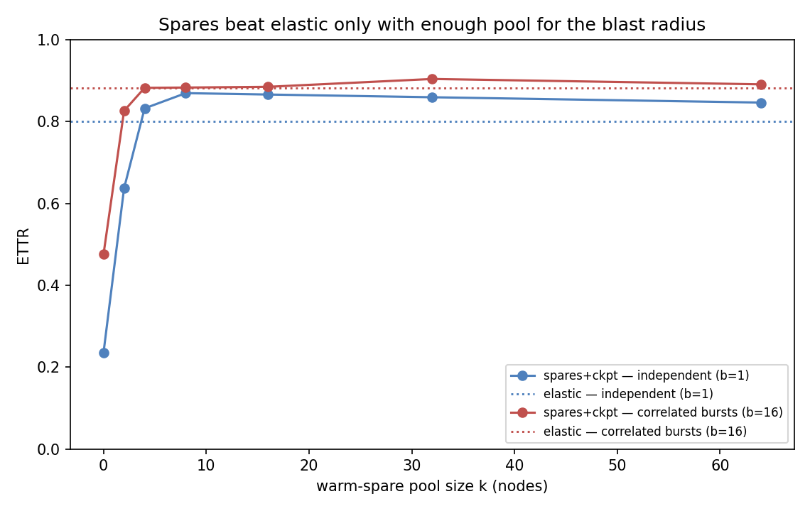
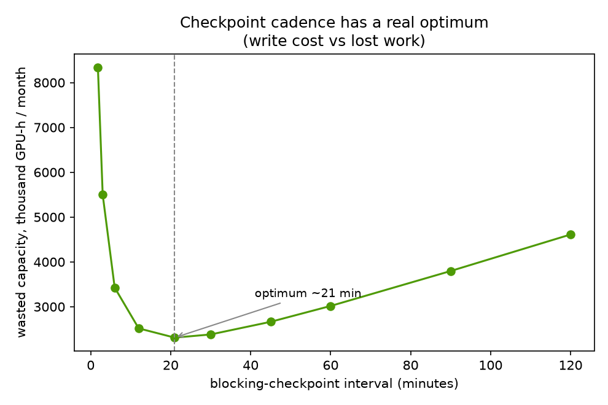

# Reliability economics: which recovery policy wins in which failure regime

Reference numbers point to [REFERENCES.md](../REFERENCES.md). Numbers are means over 8 seeds from [`sim/`](../sim/); reproduce with `python3 sim/run.py`.

## The question, corrected

The naive question — "does faster recovery save GPU-hours?" — has an obvious yes and is not worth a repo. The real question, and the one operators actually face, is: **given that you will spend on recovery, does the win come from warm spares, elastic degradation, frequent checkpointing, or faster repair — and how does the answer change with your failure process?** This study maps that. The headline is not a number; it is a **phase diagram**.

An earlier version of this model (the [v0 baseline](../v0-baseline/), kept for reference) reported a single number — "a two-node warm-spare pool is the biggest lever, 83% capacity." Five independent expert reviews, and a [prototype](../prototype/), showed that finding was an artifact of a single-Poisson, policy-independent fault process. This rebuild fixes the model and reports the map instead.

## What the model does differently

The [simulator](../sim/reliability_sim.py) makes five choices the critique demanded (details in [BUILD_SPEC](../BUILD_SPEC.md)):

1. **Shared latent events, not policy-conditioned interruptions.** Hardware faults occur on one absolute-time timeline per seed; every policy faces the *same* faults and differs only in detection and recovery. Interruptions are an *output*, not the input — so a policy that recovers well genuinely experiences fewer job stops, and no policy is scored against another's interruption stream.
2. **Correlated failures.** A base rate of single-node faults plus rarer common-cause bursts (rack/PDU/switch) that take out a *blast radius* of nodes at once. Independent Poisson is the blast-radius-1 special case.
3. **Spares as a finite queue** with swap/reload, repair and requalification clocks; return-to-pool follows repair plus requalification. A used spare is unavailable for hours; the pool can be exhausted. This is what the v0 "always-sufficient pool" got wrong.
4. **Checkpoint as a policy lever with a write cost.** Frequent checkpointing cuts lost work but costs write stalls; overlapped (async) checkpointing hides most of the stall — the ByteRobust regime [3], as the checkpoint-systems literature (CheckFreq, Gemini, just-in-time checkpointing) established [4]. There is a real Young/Daly optimum [5].
5. **Elastic-shrink is not free** — a reshard/communicator-rebuild stop per event plus a legal-shape tax (you shrink to whole data-parallel replicas), so usable capacity drops to the next legal shape, not by one node.

The headline is a **reserved-envelope productive ratio**, retained as `ettr` in the code/CSV for compatibility: productive GPU-hours divided by `(active GPUs + reserved spare GPUs) × horizon`. It is not Meta's ETTR: Meta [2, §II-D] includes eligible queue waiting in its denominator, while this single-job model has no scheduler queue and charges reserved spare capacity. MTTF/MTTR/availability are diagnostics, and the dollar layer values nonproductive reserved capacity. Subsequent ETTR labels in the plots refer to this local ratio.

## The phase diagram

Reading it (blue = warm spares + overlapped checkpoint win; red = elastic-shrink wins):

- **No spares (k = 0) loses to elastic in the modeled sweep.** Idling the fleet for every repair is the worst posture there is (16–24% ETTR); if you hold no reserve, degrade gracefully instead.
- **Elastic-shrink is competitive across the modeled sweep (~0.80).** It needs no reserved pool, degrades to the next legal shape, and beats a spare pool at small k and under large bursts — a two-node pool (the v0 "biggest lever") *loses to elastic even under independent failures*.
- **A right-sized pool + overlapped checkpointing (k ≈ 8) is the best policy (~0.87) — but only in a band, and by a thin margin over elastic.** The pool must match the blast radius: too small and it collapses to the repair wait; too large and the idle reservation — now charged to the envelope — drags ETTR back down (k = 32 scores *below* k = 8). Overlapped checkpointing is the co-lever that makes the spare policy the winner at all.
- **The winner is a region, not an ordering, and the winning margin is thin.** That honesty is the finding: recovery strategy is a design choice against your failure process; elastic is competitive almost everywhere; spares earn their keep only when right-sized to the blast radius.

## The economics

<!-- economics-headline:start -->
**Committed independent-failure scenario:** 16,384 active GPUs, 30 days (720 hours), seeds 0–7, valued at an assumed $2.50/GPU-hour.

Mean modeled nonproductive-capacity value: manual/no spares **$24,816,774.875**; elastic/no spares **$5,907,455.875**; automated recovery with eight spare nodes and overlapped checkpointing **$3,862,799.875**.

Subtracting the committed `waste_dollars` values gives **$20,953,975.000** versus manual (about $21M), and **$2,044,656.000** versus elastic (**$2,044,656** rounded to whole dollars). These are modeled capacity valuations, not realized cash savings.
<!-- economics-headline:end -->

The [committed CSV](../results/results.csv) contains `scenario=independent` rows for `manual`/0 spares, `elastic`/0, and `auto-spares-ckpt`/8. The [generated summary](../results/summary.md) rounds individual rows to whole dollars; use the CSV decimals for exact subtraction.

The scenario assumptions are:

- **One gang training job:** 2,048 active nodes × 8 GPUs = 16,384 active GPUs, for 720 hours. Eight spare nodes add 64 GPUs, so the spare policy's paid envelope is 11,842,560 GPU-hours; no-spare policies have 11,796,480 GPU-hours.
- **Independent faults:** a homogeneous Poisson input of `1.58e-4` faults/node-hour, no correlated bursts. Every policy uses the same latent event timeline for each of seeds 0–7. The rate was calibrated by transferring a public interruption count into a latent hardware-fault assumption; it is not a measured universal hardware rate. The separate `rack-bursts-b16` rows are not the source of this headline.
- **Recovery:** manual response 1 hour versus automated detection 0.033 hours; reload/swap/rendezvous 0.25 hours; repair 4 hours; spare requalification 1 hour. A used spare returns after repair plus requalification. If no spare covers the fault, a fixed-width job waits for repair. Elastic recovery pays a 0.5-hour reshard stop and shrinks in legal groups of eight nodes.
- **Checkpoints:** manual recovery uses a 0.5-hour blocking interval with 0.02-hour effective write stall; the eight-spare policy and elastic both use a 0.1-hour interval with 0.003-hour effective stall. Lost work is modeled as half the interval. Thus the manual-to-best contrast combines recovery, spares and checkpoint policy; it does not isolate automation alone.
- **Valuation:** `(reserved envelope − productive GPU-hours) × $2.50/GPU-hour`. The eight spare nodes cost `64 × 720 × $2.50 = $115,200` in this accounting, already included in `waste_dollars`. No separate power, facilities, storage/network, repair labor, software, financing or revenue model is added. An operator must establish what their own hourly valuation includes; this is neither a market quote nor a full TCO model.
- **Rounding:** the simulator rounds each seed's dollar valuation to a whole dollar, then the report averages eight seeds and prints three decimal places. Exact published differences therefore come from those CSV means, not from rounded ETTR values or already-rounded summary-table rows.

The manual-to-elastic contrast is approximately $18.9M of modeled nonproductive-capacity value; the additional contrast from elastic to the eight-spare, overlapped-checkpoint policy is approximately $2.04M. These are conditional model comparisons, not realized savings or guarantees for a purchased cluster.

**Why the previously published elastic difference changed.** The public snapshot at [`92a4cd6`](https://github.com/dimaggi-ai/reliability-economics/tree/92a4cd6) reproduces $5,875,774.000 for elastic and therefore **$2,012,974.125** versus the eight-spare policy ($2,012,974 rounded). An existing engineering correction, [`077eb6f`](https://github.com/dimaggi-ai/reliability-economics/commit/077eb6f56149e3fec663cf9aaf90c6ea7d973442), identified that completed repairs were removed before the preceding interval received productive credit, retroactively treating repaired nodes as available during repair. This review branch reuses that minimal accounting correction and its hand-computable regression; it does not adopt the unrelated event-order changes or certify their acceptance. The corrected elastic value is $5,907,455.875 and the gap is **$2,044,656.000**. The manual and spare-policy outputs, including **$20,953,975**, are unchanged. The phase figures and sensitivity results have been regenerated from the corrected source.

The checkpoint cadence alone has a real optimum:

## Public context and internal model checks

Detection time — the gap between the ~30 s InfiniBand transport timeout and the 600 s PyTorch watchdog [7] — is fixed at ~2 min, a tuned posture rather than a swept input, and the validation registry publishes the ETTR sensitivity to it. Two public comparisons provide context; only matched inputs or internal relationships are regression checks:

- **Context 1 — Meta's >90% effective training time.** A configuration with a right-sized spare pool, overlapped checkpointing and fast detection yields a local productive ratio of ~0.87. Meta's >90% effective training time on the Llama 3 405B run [1] is context, not reproduction of an equivalent numerator/denominator; the model does not establish Meta's recovery configuration or outcomes.
- **Context 2 — Meta RSC's MTTF vs N.** Sweeping cluster size, MTTF between job interruptions falls with GPU count, consistent with Meta RSC's ∝ 1/N scaling — though slightly *steeper* than 1/N at the top end (a doubling ratio approaching ~2.9× rather than 2×), which is the expected direction for real fleets and which the model does not tune to fit [2]. Treat this as a consistency check on the direction and rough magnitude, not a fitted validation.

## What a skeptic should attack

Stated plainly, because pre-empting the critique is the point:

- **Deterministic blast radius and point recovery times.** Real bursts vary in size and real repair/requal/reshard times are distributions with heavy tails; this model uses fixed values. The sweep exposes phase structure under these assumptions; robustness to different distributions has not been established.
- **Progress is linear in usable width above the legal-shape floor.** Real elastic training has pipeline-bubble and batch-size effects that make progress sub-linear; the reshard cost and legal-shape tax capture the first-order penalty, not all of it.
- **One gang training job, no inter-job scheduling** (that is the [scheduling repo's](https://github.com/dimaggi-ai/scheduler-vs-more-gpus) [9] subject) and **no inference** (serving reliability is a different metric — error budget, not ETTR).
- **SDC and stragglers are regimes, not devices, here.** Their *economic* effect (SDC [6] can invalidate the last good checkpoint; a straggler taxes every step) is representable by parameters; their detection is the [chaos-fidelity standard's](https://github.com/dimaggi-ai/ai-cluster-chaos-fidelity) [8] subject.
- **The failure rate rests on public snapshots.** The base rate is calibrated to Llama 3 [1] and cross-checked against Meta RSC [2]; a site should re-point `Config` to its own numbers. Both policy ordering and dollar magnitudes remain conditional on the selected rate and other assumptions; rate-independent robustness has not been established.

## What it is

A structural, regime-aware comparison of recovery policies using a reserved-envelope productive ratio and an explicit GPU-hour valuation, with public input context and internal regression checks. The contribution is the map and the method, not any single cell. Invariants (metric bounds, the availability relationship, shared-event determinism and internal policy contrasts) are enforced by [tests](../sim/test_reliability_sim.py).
